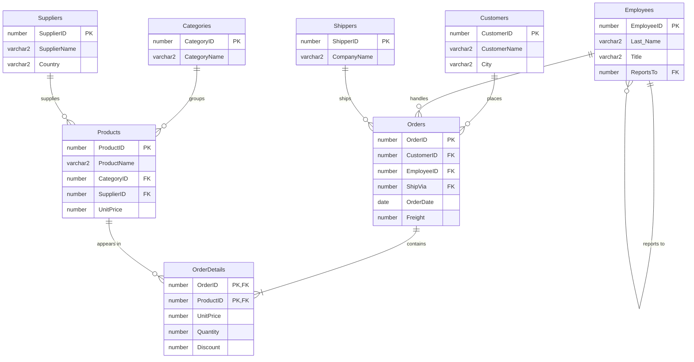

# Northwind Database — Oracle SQL

**Designing a relational database from scratch, with integrity rules that stop bad data at the door.**

A complete build of the classic **Northwind** sales database in **Oracle SQL**: 8 related tables, 40+ constraints, sequences for auto-generated keys, sample data, read-only reporting views and schema changes, organized as 8 scripts that rebuild the database from zero.

`Oracle SQL` · `SQL Developer` · `DDL / DML` · `Constraints` · `Views` · `Relational modeling`

---

## Data model

## What the project shows

**Data integrity built into the schema**
- **Primary and foreign keys** on every relationship, including a **self-reference** (`Employees.ReportsTo`) for the management hierarchy.
- **Business rules as CHECK constraints:**
  - an employee must be at least 16 at hiring (`HireDate > ADD_MONTHS(Birthdate, 192)`);
  - an order can't ship before it's placed or after its due date;
  - stock can't drop below the reorder level;
  - discounts must stay between 0 and 1;
  - supplier country must be Canada, USA or Mexico.
- **`ON DELETE CASCADE`** on order lines, so deleting an order never leaves orphan rows.
- **Composite primary key** `(OrderID, ProductID)` on order details.

**Automation and reporting**
- **7 sequences** generate primary keys, each with its own start value and increment (for example, customers start at 100 and step by 5).
- **3 read-only views** for reporting:

| View | Purpose | Technique |
|---|---|---|
| `products_view` | Products with their supplier and category | 3-table `INNER JOIN` |
| `achat_client_view` | What each customer bought, and when | 4-table `INNER JOIN` |
| `employe_view` | Orders handled and average quantity sold per employee | `GROUP BY` + `COUNT` / `AVG` |

**Schema changes** with `ALTER TABLE`: add columns, resize a column, disable a constraint, add `NOT NULL` and `UNIQUE` constraints.

Example output of `achat_client_view` with the sample data:

| CustomerName | ProductName | Quantity | UnitPrice |
|---|---|---|---|
| Aliou Diallo | Laptop | 2 | 1450 |
| Sarah Smith | Table | 1 | 1000 |
| Ariane Condé | Dress | 4 | 45 |

## Run it

Run the scripts in order in Oracle SQL Developer (or any Oracle database, including the free Oracle XE):

| Script | Step |
|---|---|
| [`01_create_tables.sql`](sql/01_create_tables.sql) | Tables and constraints |
| [`03_create_sequences.sql`](sql/03_create_sequences.sql) | Primary-key sequences |
| [`05_insert_data.sql`](sql/05_insert_data.sql) | Sample data |
| [`07_create_views.sql`](sql/07_create_views.sql) | Reporting views |
| [`08_alter_tables.sql`](sql/08_alter_tables.sql) | Schema changes |

To reset: [`06_delete_data.sql`](sql/06_delete_data.sql) empties the tables, then [`04_drop_sequences.sql`](sql/04_drop_sequences.sql) and [`02_drop_tables.sql`](sql/02_drop_tables.sql) remove everything.

## Team

Team project for **DATA1064 – SQL Programming**, Data Analytics program, CCNB Bathurst (Winter 2026), by **Sanaba Kanté** and Débora Akoua Kouassi.

**My contribution:** table design and constraints (with Débora), all sequences, and the sample data inserts. Débora led the views and the `ALTER` scripts, which we reviewed together.

---

<b>🇫🇷 Résumé en français</b>

Création complète de la base de données **Northwind** en **Oracle SQL** (cours DATA1064, CCNB Bathurst, hiver 2026) :
- 8 tables reliées, avec clés primaires et étrangères (dont une auto-référence) et des règles d'affaires en contraintes `CHECK` ;
- 7 séquences pour générer les clés ;
- 3 vues en lecture seule (jointures et `GROUP BY`) ;
- modifications de structure avec `ALTER TABLE`.

Projet en équipe avec Débora Akoua Kouassi. **Ma contribution :** conception des tables et des contraintes (avec Débora), les séquences et les insertions.

